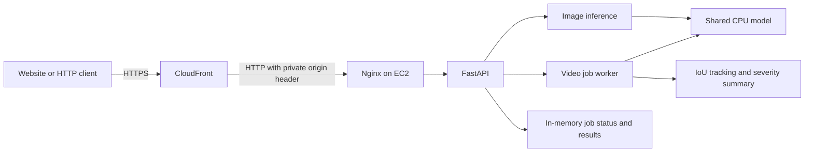

# Dump-Detection

**A CPU-based road-damage detection API for images and short videos, deployed on AWS.**

Upload a road image to receive damage classes, bounding boxes, confidence scores, and
severity estimates. Submit a video to track recurring observations across frames and
receive a summary of the estimated unique damages.

The repository contains the FastAPI service, detection and tracking code, tests, and
Terraform deployment. It does not include the former Streamlit interface, training
notebook, or a database. Despite the repository name, the model detects **road cracks
and potholes**, not garbage or illegal dumping.

| Resource | Address |
| --- | --- |
| Public API base URL | [https://d27aph0gu4g2ie.cloudfront.net](https://d27aph0gu4g2ie.cloudfront.net/docs) |
| Interactive Swagger documentation | [Open Swagger UI](https://d27aph0gu4g2ie.cloudfront.net/docs) |
| OpenAPI specification | [Download the API schema](https://d27aph0gu4g2ie.cloudfront.net/openapi.json) |
| Health check | [Check service readiness](https://d27aph0gu4g2ie.cloudfront.net/health) |
| AWS operations guide | [infra/README.md](infra/README.md) |

**The current AWS deployment is public:** no API key is required, and all website origins
are allowed through CORS. Availability depends on the AWS deployment remaining active.
Opening the base URL `/` may return 404 because there is no homepage; use `/docs` or `/health`.

## Contents

- [Capabilities and architecture](#capabilities-and-architecture)
- [Damage classes and severity](#damage-classes-and-severity)
- [Quick start with the public API](#quick-start-with-the-public-api)
- [Local installation](#local-installation)
- [Model configuration](#model-configuration)
- [API reference](#api-reference)
- [Response fields](#response-fields)
- [Website integration](#website-integration)
- [Python integration](#python-integration)
- [Configuration and authentication](#configuration-and-authentication)
- [Limits and error handling](#limits-and-error-handling)
- [AWS deployment](#aws-deployment)
- [Testing and verification](#testing-and-verification)
- [Repository layout](#repository-layout)
- [Troubleshooting](#troubleshooting)
- [Data handling and limitations](#data-handling-and-limitations)
- [Attribution and licensing](#attribution-and-licensing)

## Capabilities and architecture

- Detect four road-damage categories using Ultralytics and trained YOLO weights.
- Return structured JSON with pixel coordinates and severity information.
- Analyze videos with class-aware intersection-over-union (IoU) tracking.
- Submit video jobs and poll for completion without keeping an inference request open.
- Validate upload format, size, image dimensions, and request parameters.
- Serve an OpenAPI schema and interactive Swagger documentation.
- Support optional API keys and configurable CORS for other deployments.
- Provision the AWS service through Terraform using AWS CLI credentials.



Only one inference workload runs at a time. A video occupies the same model slot used by
image requests. New inference requests receive **429** while that slot is busy; they are
not queued. Health checks, model metadata, and job polling remain available.

## Damage classes and severity

The model must use this exact class-ID order:

| ID | RDD code | Display name | Severity type factor |
| --- | --- | --- | --- |
| 0 | D00 | Longitudinal Crack | 0.35 |
| 1 | D10 | Transverse Crack | 0.45 |
| 2 | D20 | Alligator Crack | 0.75 |
| 3 | D40 | Pothole | 1.00 |

Severity is calculated from the detected box's share of the image, its class, and model
confidence:

```text
relative_area = bounding_box_area / image_area
area_factor = sqrt(clamp(relative_area / 0.15, 0, 1))
severity_score = 0.40 * area_factor + 0.30 * type_factor + 0.30 * confidence
```

| Score range | Severity | Suggested interpretation |
| --- | --- | --- |
| 0.00–0.30 | Low | Monitor |
| >0.30–0.55 | Medium | Schedule repair |
| >0.55–0.75 | High | Priority repair |
| >0.75–1.00 | Critical | Immediate attention |

These are **designed ranking heuristics**, not validated civil-engineering assessments.
Box area is an image measurement, not damage size in metres. Confidence is a model output,
not a guarantee of correctness. The scoring constants are in
[src/utils/constants.py](src/utils/constants.py).

## Quick start with the public API

No installation, AWS credentials, or API key is needed to call the existing service.

### Check readiness

```bash
curl https://d27aph0gu4g2ie.cloudfront.net/health
```

Expected response:

```json
{
  "status": "ok",
  "model_loaded": true
}
```

### Analyze an image

Use a local image path. From a cloned repository, the included fixture is available:

```bash
curl -X POST https://d27aph0gu4g2ie.cloudfront.net/detect \
  -F "file=@samples/road_02.jpg" \
  -F "confidence=0.25"
```

PowerShell equivalent:

```powershell
curl.exe -X POST https://d27aph0gu4g2ie.cloudfront.net/detect -F "file=@samples/road_02.jpg" -F "confidence=0.25"
```

### Submit a video

```powershell
curl.exe -X POST https://d27aph0gu4g2ie.cloudfront.net/detect/video/jobs -F "file=@clip.mp4" -F "confidence=0.25" -F "frame_stride=2"
```

Read `status_url` from the **202 Accepted** response, prepend the API base URL, and poll it
every two seconds. The response contains `result` once the job completes. Full request
and response details are below.

## Local installation

### Requirements

- Git and Python with virtual-environment support. Python **3.12** is the tested version.
- A trained model with the expected class order.
- CPU inference is sufficient; CUDA and a GPU are not required.
- Allow several gigabytes of disk space for Python dependencies and weights.
- Run commands from the repository root.

### Windows / PowerShell

```powershell
git clone https://github.com/Saad-i514/Dump-Detection.git
cd Dump-Detection
python -m venv .venv
.\.venv\Scripts\python.exe -m pip install --upgrade pip
.\.venv\Scripts\python.exe -m pip install torch==2.7.1 torchvision==0.22.1 --index-url https://download.pytorch.org/whl/cpu
.\.venv\Scripts\python.exe -m pip install -r requirements.txt
```

### Linux

Install your distribution's Python venv support and OpenCV runtime libraries first.
For Ubuntu, `python3-venv`, `libgl1`, and `libglib2.0-0` are typically needed.

```bash
git clone https://github.com/Saad-i514/Dump-Detection.git
cd Dump-Detection
python3 -m venv .venv
.venv/bin/python -m pip install --upgrade pip
.venv/bin/python -m pip install torch==2.7.1 torchvision==0.22.1 --index-url https://download.pytorch.org/whl/cpu
.venv/bin/python -m pip install -r requirements.txt
```

`requirements-api.txt` contains service dependencies. `requirements.txt` includes those
dependencies plus the tools needed to run tests. Install the CPU PyTorch packages first
to avoid an unnecessary GPU-oriented installation. The AWS bootstrap performs this step.

### Install model weights

Place your own compatible weights at `models/road_damage_best.pt`, or download the
interim weights used by the current deployment:

```powershell
Invoke-WebRequest 'https://github.com/oracl4/RoadDamageDetection/raw/refs/heads/main/models/YOLOv8_Small_RDD.pt' -OutFile 'models/road_damage_best.pt'
```

Linux equivalent:

```bash
curl --fail --location \
  https://github.com/oracl4/RoadDamageDetection/raw/refs/heads/main/models/YOLOv8_Small_RDD.pt \
  --output models/road_damage_best.pt
```

See [attribution and licensing](#attribution-and-licensing) before redistributing these
third-party weights. They are not committed to this repository.

### Start the API

Windows:

```powershell
.\.venv\Scripts\python.exe -m uvicorn api.main:app --host 127.0.0.1 --port 8000 --workers 1
```

Linux:

```bash
.venv/bin/python -m uvicorn api.main:app --host 127.0.0.1 --port 8000 --workers 1
```

Open [http://localhost:8000/docs](http://localhost:8000/docs). Startup loads and warms the
model before serving requests. Keep **one worker**: job records and the inference lock
are process-local, so multiple workers would produce inconsistent job lookups and
independent model copies.

## Model configuration

Model selection follows this order:

1. `models/road_damage_best.onnx`
2. `models/road_damage_best.pt`

The HTTP API fails at startup if trained weights are absent or class labels do not match
the expected order. It does not serve detections using stock COCO fallback weights.
Supported label aliases include the RDD codes and the corresponding class names; the
four IDs must still match the table above.

To replace a model locally, stop the server, replace the appropriate file, and restart.
If you intend to use PyTorch, remove or relocate an older `.onnx` file because ONNX takes
precedence. A running process does not automatically reload changed weights.

The AWS packaging script currently packages **only `models/road_damage_best.pt`**.
Putting an ONNX file in the local directory does not switch the deployed AWS backend.
Updating AWS weights requires rebuilding the deployment bundle and redeploying.

Current detection defaults include 640-pixel inference size, IoU threshold 0.45, and a
maximum of 100 detections per processed frame. These are code settings, not exposed HTTP
parameters. `/model` reports the active model and supported upload limits.

## API reference

All paths below are relative to the public base URL or your local server.

| Method | Path | Successful response | Availability |
| --- | --- | --- | --- |
| GET | `/health` | 200 JSON | Public and local |
| GET | `/model` | 200 JSON | Public and local |
| POST | `/detect` | 200 JSON | Public and local |
| POST | `/detect/video/jobs` | 202 JSON | Public and local |
| GET | `/detect/video/jobs/{job_id}` | 200 JSON | Public and local |
| POST | `/detect/video` | 200 JSON | Local by default; AWS returns 409 |
| GET | `/docs` | Swagger UI | Public and local |
| GET | `/openapi.json` | OpenAPI schema | Public and local |

### GET /health

Returns `status` and `model_loaded`, as shown in the quick start. This endpoint remains
unauthenticated even when an optional API key is configured. It is a readiness check,
not a measurement of model accuracy or whether the inference slot is currently free.

### GET /model

Returns:

| Field | Meaning |
| --- | --- |
| `model` | Active filename, such as `road_damage_best.pt` |
| `backend` | `pytorch` or `onnx` |
| `classes` | Four entries with `class_id`, `code`, `name`, `bgr`, `hex`, and `type_factor` |
| `max_upload_bytes` | Image limit: 10,485,760 bytes |
| `max_image_pixels` | Image width × height limit: 20,000,000 |
| `max_video_bytes` | Video limit: 52,428,800 bytes |
| `max_video_frames` | Decoded frame limit: 1,800 |
| `max_video_frame_pixels` | Per-frame pixel limit: 2,073,600 |

### POST /detect

Send **multipart/form-data**, not a JSON body or a remote image URL.

| Field | Type | Required | Default | Constraint |
| --- | --- | --- | --- | --- |
| `file` | Uploaded image | Yes | — | JPEG, PNG, or WebP |
| `confidence` | Number | No | 0.25 | Between 0 and 1, inclusive |

Example response from the included `samples/road_02.jpg`, with numbers rounded for
readability. Model changes may change the detections:

```json
{
  "width": 675,
  "height": 453,
  "count": 1,
  "detections": [
    {
      "class_id": 2,
      "code": "D20",
      "class_name": "Alligator Crack",
      "confidence": 0.565547,
      "bbox": [11.499146, 38.416477, 675.0, 175.366516],
      "bbox_area": 90866.467839,
      "relative_area": 0.297168,
      "severity_score": 0.794664,
      "severity_level": "Critical",
      "severity_hex": "#E74C3C",
      "severity_bgr": [60, 76, 231]
    }
  ]
}
```

A response with `count: 0` and `detections: []` is valid. It means no detection met the
configured threshold, not that the image is guaranteed damage-free. Detections are sorted
by severity score, highest first. EXIF orientation is applied before inference.

### POST /detect/video/jobs

Use this route for AWS video processing. Uploading finishes before the API returns a
job identifier; the inference then runs in the background.

| Field | Type | Required | Default | Constraint |
| --- | --- | --- | --- | --- |
| `file` | Uploaded video | Yes | — | MP4, MOV, AVI, or MKV |
| `confidence` | Number | No | 0.25 | Between 0 and 1, inclusive |
| `frame_stride` | Integer | No | 2 | Between 1 and 10, inclusive |

Example **202 Accepted** response:

```json
{
  "job_id": "0123456789abcdef0123456789abcdef",
  "status_url": "/detect/video/jobs/0123456789abcdef0123456789abcdef"
}
```

The example ID is illustrative; use the ID returned by your request. Acceptance confirms
the job was submitted, not that its video has fully decoded successfully. A later decoding
or frame-limit failure is reported in the job status.

### GET /detect/video/jobs/{job_id}

Poll the returned URL approximately every two seconds. Do not resubmit the video to check
its status. A processing response is:

```json
{
  "job_id": "0123456789abcdef0123456789abcdef",
  "status": "processing"
}
```

Example completed response for an illustrative clip with no detections:

```json
{
  "job_id": "0123456789abcdef0123456789abcdef",
  "status": "completed",
  "result": {
    "frames_total": 60,
    "frames_processed": 30,
    "fps": 30.0,
    "duration_s": 2.0,
    "raw_detections": 0,
    "unique_damages": 0,
    "duplication_ratio": 0.0,
    "tracks": [],
    "by_class": {},
    "by_severity": {},
    "peak_frame": 0,
    "peak_count": 0
  }
}
```

Example failed response:

```json
{
  "job_id": "0123456789abcdef0123456789abcdef",
  "status": "failed",
  "error": "Video exceeds 1800 frames",
  "error_status": 413
}
```

A known failed job is still returned with **HTTP 200**: inspect `status` and
`error_status` in the JSON. An unknown, expired, or evicted job returns **HTTP 404**.
Results expire one hour after the job record's latest update. At most 100 records are
retained, so older results may be evicted sooner. Restarts clear every job record.

### POST /detect/video

This local endpoint takes the same multipart fields as the job-submission route and
returns the video summary directly after processing. It does not return a job ID.

```powershell
curl.exe --max-time 900 -X POST http://localhost:8000/detect/video -F "file=@clip.mp4" -F "frame_stride=2"
```

The AWS deployment sets `RDD_ASYNC_VIDEO_ONLY=1`, so this route returns **409** with a
message directing callers to `/detect/video/jobs`. This avoids holding a CloudFront
request open for a potentially long CPU inference.

## Response fields

### Detection object

| Field | Meaning |
| --- | --- |
| `class_id`, `code`, `class_name` | Damage taxonomy identifiers and display name |
| `confidence` | Detection confidence, from 0 to 1 |
| `bbox` | `[x1, y1, x2, y2]` in image pixels, with origin at the top-left |
| `bbox_area` | Box width × height in square pixels |
| `relative_area` | Box area divided by frame area; a fraction, not a percentage |
| `severity_score` | Heuristic score from 0 to 1 |
| `severity_level` | `Low`, `Medium`, `High`, or `Critical` |
| `severity_hex` | CSS colour for the severity level |
| `severity_bgr` | The same colour in OpenCV BGR order, not RGB |

Image response `width` and `height` refer to the EXIF-oriented image used for inference.
When drawing boxes on a resized preview, scale the coordinates to the preview dimensions.
The API returns JSON; it does not provide annotated-image or annotated-video downloads.

### Video summary and tracks

| Field | Meaning |
| --- | --- |
| `frames_total` | Number of frames decoded, including frames skipped for inference |
| `frames_processed` | Number passed to the model |
| `fps` | Decoder-reported frame rate; the pipeline uses 30 if it is unavailable/zero |
| `duration_s` | Decoded frame count divided by FPS |
| `raw_detections` | All boxes across processed frames |
| `unique_damages` | Number of tracks created by the tracker |
| `duplication_ratio` | Raw detections / unique damages, or 0 when no tracks exist |
| `by_class`, `by_severity` | Counts aggregated over each track's best observation |
| `peak_frame` | Zero-based frame index with the highest simultaneous detection count |
| `peak_count` | Number of detections on that frame |
| `tracks` | One entry per tracked damage |

Each track contains `track_id`, `class_id`, `first_frame`, `last_frame`, `hits`, `bbox`,
and `best`. `bbox` is the most recent box; `best` is a complete detection object from the
most severe observation and may come from an earlier frame. Frame indices refer to the
original decoded sequence, not the processed-frame sequence. `hits` counts observations
in processed frames. IDs are local to a single video.

The tracker matches only detections of the same class, with an IoU threshold of 0.40 and
a maximum gap of 15 original frame indices. With stride 2 it processes frames 0, 2, 4,
and so on. Larger strides reduce compute but may miss damage or split tracks. Unique
counts are estimates, not guaranteed counts of physical defects.

## Website integration

Use the public URL from a browser or a frontend framework. The current deployment permits
all origins and does not use cookie authentication. Do not set `Content-Type` manually
when sending `FormData`: the browser must include the multipart boundary.

### JavaScript image upload

`file` below is a browser `File`, for example `fileInput.files[0]`.

```javascript
const API_BASE = "https://d27aph0gu4g2ie.cloudfront.net";

async function detectImage(file, confidence = 0.25) {
  const form = new FormData();
  form.append("file", file);
  form.append("confidence", String(confidence));

  const response = await fetch(`${API_BASE}/detect`, {
    method: "POST",
    body: form,
  });
  if (!response.ok) {
    throw new Error(`HTTP ${response.status}: ${await response.text()}`);
  }
  return response.json();
}
```

### JavaScript video submission and polling

This example bounds polling to 15 minutes. Stopping polling does not cancel a server job;
there is currently no cancellation endpoint.

```javascript
const API_BASE = "https://d27aph0gu4g2ie.cloudfront.net";

async function detectVideo(file, confidence = 0.25, frameStride = 2) {
  const form = new FormData();
  form.append("file", file);
  form.append("confidence", String(confidence));
  form.append("frame_stride", String(frameStride));

  const submitted = await fetch(`${API_BASE}/detect/video/jobs`, {
    method: "POST",
    body: form,
  });
  if (!submitted.ok) {
    throw new Error(`HTTP ${submitted.status}: ${await submitted.text()}`);
  }
  const job = await submitted.json();
  const deadline = Date.now() + 15 * 60 * 1000;

  while (Date.now() < deadline) {
    await new Promise(resolve => setTimeout(resolve, 2000));
    const response = await fetch(`${API_BASE}${job.status_url}`);
    if (!response.ok) {
      throw new Error(`HTTP ${response.status}: ${await response.text()}`);
    }
    const status = await response.json();
    if (status.status === "completed") return status.result;
    if (status.status === "failed") throw new Error(status.error);
  }
  throw new Error(`Polling timed out; check ${API_BASE}${job.status_url}`);
}
```

For 429 responses, wait and retry with backoff instead of sending requests repeatedly.
The application sends `Retry-After: 5` when the model is busy. Not all proxy-generated
errors include that header or a JSON body, and it is not exposed to cross-origin browser
JavaScript by the current CORS configuration. A conservative five-second initial delay
is suitable for a frontend retry policy. Do not blindly retry a video submission after a
network timeout: it may already have been accepted, and submissions have no idempotency key.

## Python integration

The development requirements already install `httpx`. For a separate client environment,
install it with `python -m pip install httpx`.

### Image request

```python
from pathlib import Path
import httpx

API_BASE = "https://d27aph0gu4g2ie.cloudfront.net"

with httpx.Client(base_url=API_BASE, timeout=60) as client:
    path = Path("samples/road_02.jpg")
    with path.open("rb") as image:
        response = client.post(
            "/detect",
            files={"file": (path.name, image, "image/jpeg")},
            data={"confidence": "0.25"},
        )
    response.raise_for_status()
    result = response.json()
    for detection in result["detections"]:
        print(detection["class_name"], detection["bbox"], detection["severity_level"])
```

### Video request

```python
from pathlib import Path
import time
import httpx

API_BASE = "https://d27aph0gu4g2ie.cloudfront.net"

with httpx.Client(base_url=API_BASE, timeout=120) as client:
    path = Path("clip.mp4")
    with path.open("rb") as video:
        submitted = client.post(
            "/detect/video/jobs",
            files={"file": (path.name, video, "video/mp4")},
            data={"confidence": "0.25", "frame_stride": "2"},
        )
    submitted.raise_for_status()
    job = submitted.json()
    deadline = time.monotonic() + 900

    while time.monotonic() < deadline:
        time.sleep(2)
        response = client.get(job["status_url"])
        response.raise_for_status()
        status = response.json()
        if status["status"] == "failed":
            raise RuntimeError(status["error"])
        if status["status"] == "completed":
            print(status["result"])
            break
    else:
        raise TimeoutError(f"Check job status at {API_BASE}{job['status_url']}")
```

## Configuration and authentication

Set environment variables before starting the API. A plain `.env` file is not loaded
automatically. Changing a terminal variable does not reconfigure an already running server.

| Variable | Default | Purpose |
| --- | --- | --- |
| `RDD_API_KEY` | Empty | If nonempty, require an `X-API-Key` header on model, detection, and job routes |
| `RDD_CORS_ORIGINS` | Empty | Comma-separated allowed origins; `*` permits every origin |
| `RDD_ASYNC_VIDEO_ONLY` | Unset | Exactly `1` disables synchronous `/detect/video` with HTTP 409 |
| `YOLO_AUTOINSTALL` | Set to `false` by the package if absent | Prevent Ultralytics from installing optional packages during requests |

Example private local configuration in PowerShell:

```powershell
$env:RDD_API_KEY = .\.venv\Scripts\python.exe -c "import secrets; print(secrets.token_urlsafe(32))"
$env:RDD_CORS_ORIGINS = 'http://localhost:3000,https://your-website.example'
.\.venv\Scripts\python.exe -m uvicorn api.main:app --host 127.0.0.1 --port 8000 --workers 1
```

In another terminal, provide the same key through a securely supplied environment variable
and send `X-API-Key`. Swagger's **Authorize** button supports this header. `/health`,
`/docs`, and `/openapi.json` remain public. API keys embedded in frontend code are visible
to users; keep private credentials in a backend integration instead.

Local CORS is disabled by default. The AWS systemd service explicitly sets public CORS
and asynchronous-only video processing. Changing a local variable does not change AWS;
update the deployment's server configuration and redeploy to change its behavior.

## Limits and error handling

### Upload and compute limits

| Limit | Value |
| --- | --- |
| Image upload | 10 MiB (10,485,760 bytes) |
| Image resolution | 20,000,000 pixels |
| Video upload | 50 MiB (52,428,800 bytes) |
| Video resolution | 2,073,600 pixels per frame; for example 1920 × 1080 |
| Video length | 1,800 decoded frames, including skipped frames |
| AWS total HTTP body | 51 MiB, including multipart overhead |
| AWS POST rate | 10/minute/client IP, burst allowance 3 |
| AWS connections | 10/client IP |
| Inference concurrency | One workload per server process |
| Retained jobs | Up to 100, with one-hour expiry from their latest update |

The frame limit corresponds to 60 seconds at 30 FPS, 30 seconds at 60 FPS, or 75 seconds
at 24 FPS. Increasing `frame_stride` does not bypass the decoded-frame or resolution limit.
MP4/MOV/AVI/MKV are containers; their embedded codecs must also be supported by OpenCV.
Limits detected during a background job appear as a failed job, not a partial success.

### HTTP statuses

| Status | Meaning and next step |
| --- | --- |
| 200 | Successful image/metadata request or known job status; inspect a job's `status` field |
| 202 | Video job accepted; poll `status_url` |
| 400 | Empty, corrupt, unsupported encoded content, or invalid container |
| 401 | Missing/incorrect key on a deployment with `RDD_API_KEY` configured |
| 404 | Unknown route or unknown/expired/evicted job |
| 409 | Synchronous video is disabled; use the job route |
| 413 | Upload, image dimensions, video dimensions, or decoded frame count exceeds limits |
| 415 | Unsupported image format or video filename extension |
| 422 | Missing multipart file or invalid field values |
| 429 | Model busy or proxy rate limit exceeded; wait before retrying |
| 500 | Unexpected server error; inspect server logs |
| 502 / 503 / 504 | Proxy/backend availability, connection limits, or timeouts; check health and logs |

FastAPI errors commonly have a JSON `detail` field. Validation errors may contain a list
of details. Nginx/CloudFront errors can be HTML or text, so clients should not assume
every failure is JSON. Proxy-generated failures may also lack the API's CORS headers.

## AWS deployment

The full operations guide is in [infra/README.md](infra/README.md).

### Infrastructure

| Component | Configuration |
| --- | --- |
| Region | `ap-southeast-1` by default |
| Compute | One Ubuntu EC2 `t3.small`, 2 vCPUs, 2 GiB RAM, 2 GiB swap |
| Disk | 24 GiB encrypted gp3 EBS |
| Public address | CloudFront-managed HTTPS hostname; no custom domain required |
| Origin | Elastic IP and Nginx, forwarding to Uvicorn on loopback port 8000 |
| Model and code delivery | Private S3 bundle, downloaded using an EC2 instance role |
| Origin protection | CloudFront IP-prefix security group plus a private origin header |
| Management | AWS Systems Manager; no public SSH access |
| Service management | systemd bootstrap and API services |
| Cache behavior | API response caching disabled |

Viewer connections require HTTPS. **CloudFront-to-origin traffic is HTTP**; the origin
header and network rules restrict access but do not provide end-to-end encryption. Add
an HTTPS origin with an appropriate certificate if end-to-end TLS is required.

### Provision from Windows

Prerequisites:

- AWS CLI configured with credentials for the intended account.
- Terraform 1.6+ on PATH.
- Permissions for EC2, IAM, S3, SSM, and CloudFront.
- A default VPC and public default subnet in the chosen region.
- The local `.venv` and `models/road_damage_best.pt` file.

From the repository root:

```powershell
aws sts get-caller-identity
.\scripts\deploy-aws.ps1
```

**This script creates billable resources and applies its saved Terraform plan without a
second confirmation prompt.** It verifies AWS identity, packages `api/`, `src/`, the
PyTorch model, and runtime requirements, then initializes, validates, plans, and applies
Terraform. The server installs CPU PyTorch and dependencies at first boot. Allow roughly
10–15 minutes for installation and CloudFront propagation.

To inspect a plan before applying it, run the steps separately:

```powershell
.\.venv\Scripts\python.exe scripts/package_deploy.py
terraform -chdir=infra init -input=false
terraform -chdir=infra validate
terraform -chdir=infra plan '-out=deploy.tfplan' -input=false
# After reviewing the plan:
terraform -chdir=infra apply deploy.tfplan
terraform -chdir=infra output
```

Terraform variables are `aws_region` and `instance_type`. Check account eligibility before
changing instance type; a Free-plan account may permit only specific instance families.
The default T3 configuration uses standard CPU credits to avoid surplus-credit charges,
so sustained video processing can become slower when credits are exhausted.

### Outputs and readiness

```powershell
$api = terraform -chdir=infra output -raw api_url
Invoke-RestMethod "$api/health"
terraform -chdir=infra output -raw docs_url
terraform -chdir=infra output -raw instance_id
terraform -chdir=infra output -raw deployment_bucket
```

The instance's port 8000 is deliberately not public. Use the CloudFront URL for requests.

### Logs and maintenance

Use AWS Systems Manager Run Command with the instance ID from Terraform. Useful commands
to execute on the server are:

```bash
systemctl status rdd-bootstrap rdd-api nginx --no-pager
journalctl -u rdd-bootstrap -n 60 --no-pager
journalctl -u rdd-api -n 60 --no-pager
free -m
```

See the [AWS CLI example](infra/README.md#operations-and-costs) for submitting these
commands without SSH. Inspect bootstrap logs if the API has not started after provisioning.

### Updates, state, and teardown

Pushing a GitHub commit does **not** deploy it. Run the deployment workflow to publish code
or model changes to AWS. The bundle's content hash is part of its S3 key, and updated user
data replaces the EC2 instance. Rebuilding the archive can change its hash even without a
source edit because the archive contains timestamps. Always review the plan: redeployment
can interrupt service and clears in-memory jobs. The existing CloudFront hostname is
retained when updating the same Terraform state.

Terraform state is local at `infra/terraform.tfstate`, contains the private origin token,
and is excluded from Git. Keep it safe. A fresh clone does not contain the state for an
existing deployment; coordinate state/backend access before managing that deployment
from another machine. Use a protected remote backend for shared administration.

To delete this deployment:

```powershell
terraform -chdir=infra destroy
```

Review the destroy plan carefully. It removes the managed server, disk, distribution,
and dedicated deployment bucket, including its code/model bundle. It does not delete
local weights or unrelated AWS instances. CloudFront removal can take several minutes.

### Costs

The deployment-time estimate for a continuously running Singapore `t3.small` service was
approximately **$25–30/month before significant traffic and before credits**, including
compute and basic supporting resources. This is not a fixed quote or spending cap.
Check current AWS pricing and billing for EC2, EBS, public IPv4, S3, and CloudFront.
Free Tier credits can offset usage only until they expire or are exhausted. A public API
allows other users to consume those resources even when its owner is not using it.

## Testing and verification

With dependencies and trained weights installed:

```powershell
.\.venv\Scripts\python.exe -m pytest tests/ -q
```

The cleaned repository's suite has **99 tests**. It covers detection invariants, severity
boundaries, video tracking, real-model API requests, input validation, authentication,
upload/frame limits, job success/failure, busy-model handling, and temporary-file cleanup.
API integration tests skip if trained weights are absent; other core model tests can
resolve fallback weights. Install the intended trained model to validate the actual service.

Deployment verification has also exercised public HTTPS health, Swagger/OpenAPI, browser
CORS preflight, image inference, and background video completion. Those smoke checks are
not accuracy benchmarks, sustained-load tests, or a high-availability guarantee.

For Terraform checks without applying changes:

```powershell
terraform -chdir=infra fmt -check
terraform -chdir=infra validate
```

## Repository layout

```text
api/
  main.py                  Routes, validation, CORS, auth, shared model lifecycle
  jobs.py                  Single-worker background jobs and temporary results
src/
  core/
    detector.py            Model wrapper and detection objects
    severity.py            Scoring and severity bands
    video.py               Video analysis and class-aware IoU tracking
  utils/
    config.py              Model paths and selection
    constants.py           Taxonomy, scoring weights, and inference defaults
infra/
  main.tf                  AWS resources, variables, and outputs
  user-data.sh.tftpl       Server bootstrap, Nginx, and systemd configuration
  .terraform.lock.hcl      Terraform provider version/checksum lock
  README.md                Focused AWS operations guide
scripts/
  package_deploy.py        Private code/model bundle creation
  deploy-aws.ps1           AWS identity check and Terraform workflow
tests/                     API, detector, severity, and video tests
samples/road_02.jpg         Integration-test image
models/.gitkeep            Model directory placeholder; weights are not in Git
requirements-api.txt       Service dependencies
requirements.txt           Service plus test dependencies
conftest.py                Test import-path setup
```

Local environments, logs, weights, runtime uploads, deployment archives, and Terraform
state/plans are excluded from version control.

## Troubleshooting

| Symptom | What to check |
| --- | --- |
| Startup says trained weights are missing | Put the model at the documented path; confirm you downloaded a binary rather than an HTML error page |
| Startup rejects class order | Check IDs 0–3 against D00/D10/D20/D40; a four-class model alone is not enough |
| Old model still appears | Restart the process; check for an ONNX file overriding the PT file |
| Browser gets a CORS error locally | Set the exact origin, including scheme and port, in `RDD_CORS_ORIGINS` before startup |
| Public browser request fails during overload | Proxy errors can lack CORS headers; inspect HTTP status using cURL and back off |
| `/` returns 404 | No homepage is defined; use `/docs` |
| `/detect/video` returns 409 on AWS | Submit to `/detect/video/jobs` and poll its returned URL |
| Job returns 404 | Check the ID; results may have expired, been evicted, or been lost during restart |
| Upload returns 422 | Use multipart field `file`; ensure `confidence` and `frame_stride` are in range |
| 429 while submitting an image or video | Another inference is running or the proxy rate limit was reached; retry later |
| Video job fails with 413 | Trim the clip or reduce resolution; stride does not bypass decoded-frame limits |
| MP4 is rejected or cannot decode | Confirm it is a real supported container and that its codec works in the installed OpenCV build |
| No damage detected | Check camera angle, image quality, and confidence threshold; lowering the threshold may also add false positives |
| AWS endpoint returns 502/504 after provisioning | Check bootstrap/API logs and model startup before assuming provisioning has failed |
| Slow video processing on AWS | CPU-only inference and depleted T3 credits can increase processing time |
| Terraform cannot find the deployment bundle | Run `scripts/package_deploy.py` before planning |
| Terraform rejects instance type | Query eligible types for your AWS account/plan before choosing a replacement |

## Data handling and limitations

- Image requests are processed in memory by the endpoint; multipart parsing/proxies may
  temporarily spool uploads to disk. Videos use temporary files removed after processing.
- Results are not saved to a database. Job status and results live in one process and
  disappear on restart; temporary cleanup after a crash is not the same as a successful
  request's cleanup.
- The public service has no per-user ownership checks. Anyone who knows a job's random
  status URL can read its result. Treat job URLs as sensitive if results are private.
- There is no persistent job queue, cancellation route, webhook, or automatic retry of
  a failed job. Do not scale to multiple workers without redesigning job storage and locking.
- Tracking is a geometric heuristic. Occlusion, rapid camera movement, large stride, or
  repeated views can split one defect into multiple tracks or merge nearby observations.
- Detection accuracy depends on the model and domain. A successful HTTP response does
  not establish road safety, physical damage size, repair cost, or engineering urgency.
- This is a single-server deployment. Maintenance, restarts, exhausted credits, or AWS
  outages can make it unavailable. It has not been validated for sustained production load.
- The API returns structured JSON only; it has no frontend, GIS inventory, live webcam
  streaming, or downloadable annotated-media endpoint.

## Attribution and licensing

Core detection, severity, and tracking code derives from
[IhsanKT/road-damage-detector](https://github.com/IhsanKT/road-damage-detector). Original
Git history and attribution are retained; the current repository focuses on the API
and AWS deployment.

The interim model is `YOLOv8_Small_RDD.pt` from
[oracl4/RoadDamageDetection](https://github.com/oracl4/RoadDamageDetection), trained on
road-damage data. Its source repository does not publish a model licence, so redistribution
rights are unclear. Obtain appropriate permission or use suitably licensed/self-trained
weights before redistribution. The model is excluded from Git.

This repository does not currently include a standalone project `LICENSE` file. Public
availability should not be treated as an automatic redistribution grant. Check the
applicable licences of upstream code, model weights, and dependencies for your use case.
